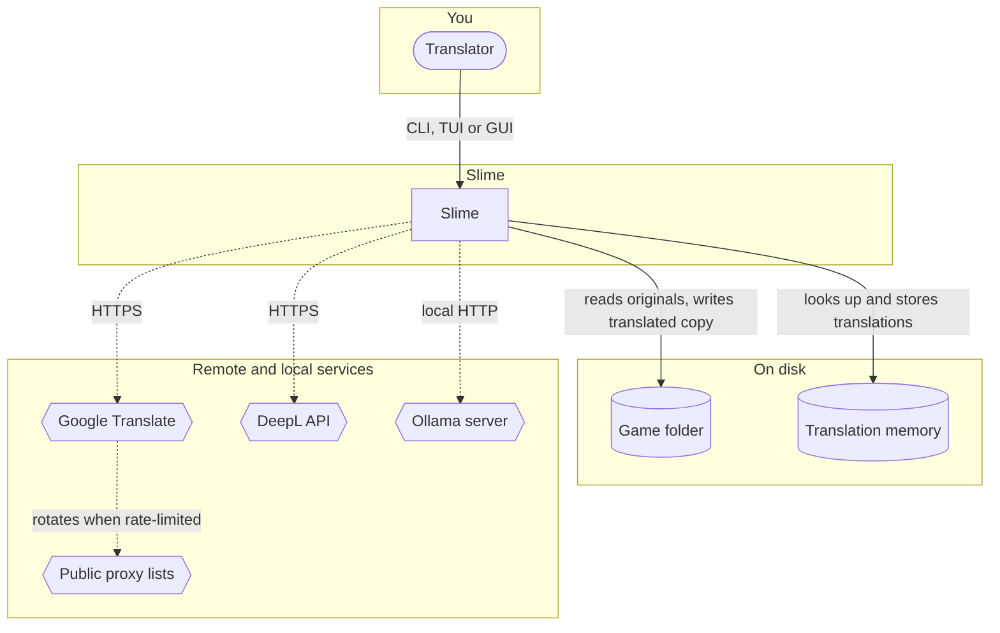
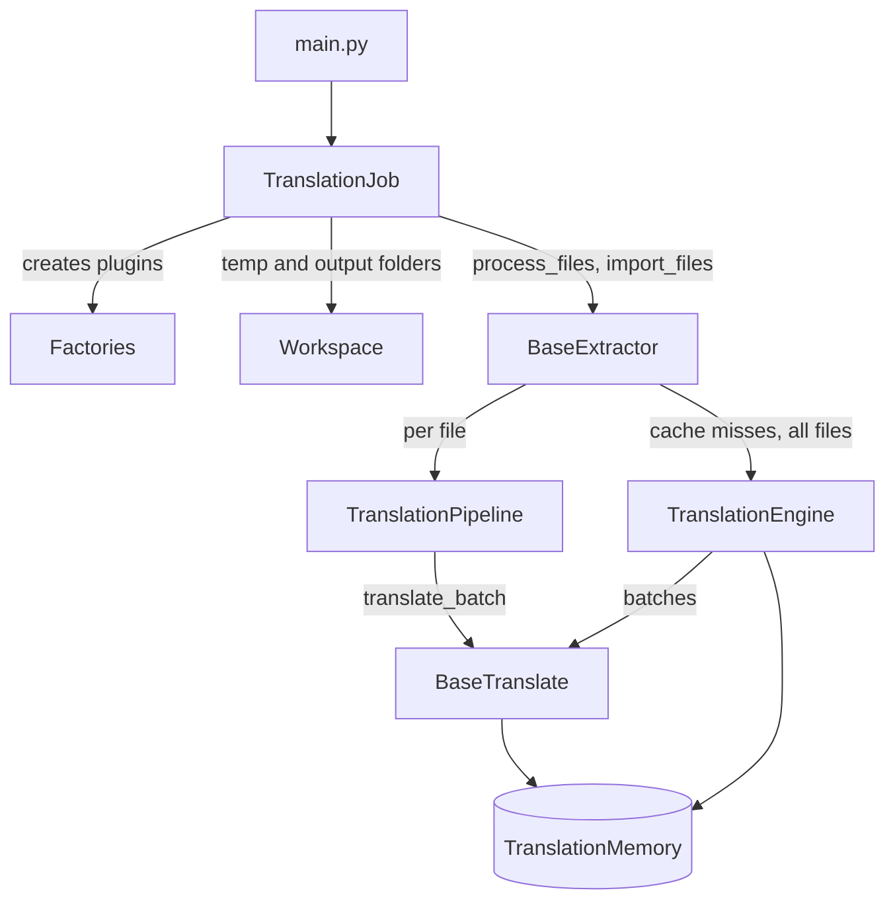
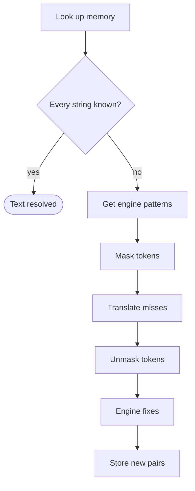
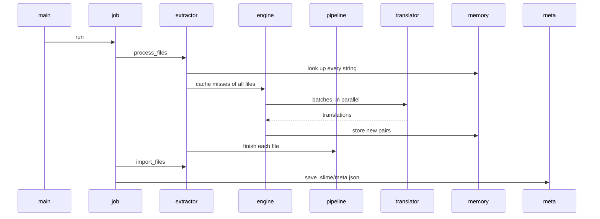

# System Architecture — Slime (Extractor & Translation)

**Slime** is a modular Python toolkit that extracts the text of video games and structured datasets (RPG Maker, WOLF RPG Editor, CSV, JSON), masks variable tokens, translates it, and writes it back. Game engines and translation providers are plugins registered in `src/factory.py`, so the core flow does not change when one is added.

---

## 1. System Overview

Slime runs as one local process, started from the CLI/TUI (`main.py`, `src/cli.py`) or the PyQt5 GUI (`src/gui.py`). It reads a game folder, writes the translated files to an output folder, and keeps every translation it has made in a local SQLite memory. The figure shows what it touches.



---

## 2. Module Map

Dependencies between the modules that own a responsibility; utilities every module imports (`src/utils/`, `src/exceptions.py`, `src/i18n.py`) are left out. The figure answers "who calls whom"; the patterns below say why.



### 2.1 Factory & plugin registration (`src/factory.py`)
* `@register_extractor(name, aliases=...)` and `@register_translator(name, aliases=...)` register engines, formats and providers.
* `discover_extractors` / `discover_translators` import the local modules first, then load the `slime.extractors` and `slime.providers` entry points declared in `pyproject.toml`.

### 2.2 Segment model (`src/extractor/Segment.py`)
* A `Segment` is a frozen unit of text with an `id`, a `source`, a `context` and `constraints`.
* `context` and `constraints` are wrapped in `SegmentContext`, a read-only mapping over `MappingProxyType`, so workers cannot mutate each other's state.
* `context["kind"]` is mandatory: `Segment.__post_init__` raises `ValueError` without it.

### 2.3 Format adapters (`src/extractor/FormatAdapter.py`)
`FormatAdapter` is a Protocol that separates file formats from translation logic: `JsonFormatAdapter` and `EvtextFormatAdapter` are the built-in ones, and RPG Maker (`RVDataAdapter`) and WOLF (`WolfBinaryAdapter`) ship their own. A JSON file that was loaded and not changed (`_is_dirty` false) is written back byte for byte.

### 2.4 Event command strategies (`src/extractor/EventCommandStrategy.py`)
`EventCommandStrategy` is the base class of one-opcode handlers, and `walk_event_commands` traverses a command list with them. The RPG Maker strategies live in `rpgmaker/RPGEventStrategy.py` (message 101/401, choices 102, name change 320, script 355, plugin commands 356/357 in `RPGEventCodes.py`); the WOLF ones in `wolfrpg/WolfEventStrategy.py`.

### 2.5 Translation pipeline (`src/pipeline.py`)
`BaseExtractor._pipeline_translate` runs one file through an ordered chain of steps. If every string is already in the memory (or in this session's translations), the first step resolves the file and the others return immediately.



* **Masking** replaces escape codes and variables (`\V[1]`, `\N[2]`, `<center>`) with placeholders such as `__XTOK_<n>__` (`TextsUtils.mask_tokens_in_structure`); unmasking failures propagate so a placeholder is never written to a game file.
* **Translate** is skipped in offline / memory-only mode and when the circuit breaker is open.
* **Store** never saves a pair that still contains a placeholder or whose translation equals the source.

### 2.6 Concurrency (`src/translate/TranslationEngine.py`, `src/extractor/BaseExtractor.py`)
* `BaseExtractor.process_files` runs a slow pool (`EXTRACTOR_MAX_WORKERS`, default 8) and a fast pool (`EXTRACTOR_FASTLANE_WORKERS`, default 16). A prescan sends files fully covered by the memory to the fast pool.
* `TranslationEngine` batches the remaining unique strings across files and runs the batches in a `ThreadPoolExecutor` capped by the provider's `MAX_REQUESTS_SIMULTANEOUSLY` (4 for Google, 10 for Ollama).

---

## 3. Translation Providers

Providers implement the `TranslationProvider` protocol (`src/translate/Provider.py`) through `BaseTranslate`:

| Provider | Module | Strategy |
| :--- | :--- | :--- |
| **Google Translate** | `src/translate/GoogleTranslate.py` | Public endpoint, batched, proxy pool when rate-limited |
| **DeepL API** | `src/translate/DeeplTranslate.py` | Official REST API (free or paid endpoint) |
| **Ollama** | `src/translate/OllamaTranslate.py` | Local LLM chosen by `OLLAMA_MODEL`, prompted with the game synopsis |

### Persistent Translation Memory (`src/translate/TranslationMemory.py`)
* SQLite database `memory.db`; its location comes from `get_memory_db_path` (`SLIME_MEMORY_DB`, then the user data directory, with a legacy `cache/memory.db` fallback).
* One `segment` row per `(src_lang, tgt_lang, source_hash, engine)` (unique index), with an FTS5 index over the source text; `game_segment` links games to hashes.
* WAL mode: writes go through one connection per database file, shared by every thread and serialized by its lock; each thread reads through its own read-only connection, without the lock.

## 4. Proxy Pool (`src/services/ProxyManager.py`)
* Used by `GoogleTranslate` only. When Google answers HTTP 429 to the direct IP, the manager blocks the direct IP with an exponentially growing cooldown and routes requests through validated HTTP proxies fetched from public lists, then retries the direct IP.
* Provider-level retries for other transient statuses (408, 429, 5xx) are in `BaseExtractor.process_file`.

---

## 5. Codebase Directory Structure

```text
├── main.py                     # CLI entry point, argument parsing, backup helpers
├── pyproject.toml              # Packaging metadata, dependencies, plugin entry points
├── src/
│   ├── factory.py              # Plugin registration and discovery
│   ├── pipeline.py             # Cache lookup, masking, translation, unmasking, fixing
│   ├── workspace.py            # Temp working folders and atomic commit to the output
│   ├── job.py                  # TranslationJob: wires plugins, runs, records metadata
│   ├── cli.py / gui.py         # Textual terminal UI / PyQt5 GUI
│   ├── extractor/              # BaseExtractor, Segment, FormatAdapter, CSV/JSON extractors
│   │   ├── rpgmaker/           # RPG Maker extractor, strategies, RVData adapter
│   │   └── wolfrpg/            # WOLF RPG extractor, strategies, Huffman, archives
│   ├── translate/              # BaseTranslate, TranslationEngine, providers, TranslationMemory
│   ├── services/               # GameDetector, GameMetadata, ProxyManager, SettingsStore, FileNameTranslator
│   └── utils/                  # TextsUtils, RubyMarshal, LanguageCodes, paths, ClipboardUtils
└── tests/                      # pytest suite
```

---

## 6. Execution Lifecycle

`GameDetector.detect_game_environment` asks every registered extractor's `detect` for a score and keeps the best; `main.run_workflow` uses it to fill in `--input` when it is missing. Then `TranslationJob.run` does the work; the figure uses the module-map ids.



* Before extraction, `main.ensure_backup` copies the input to `<input>-<source lang>`, hardlinking when it can (`main.py:133`); `Workspace` only provides the temp `process/` and `output/` folders and commits atomically (`Workspace.commit`).
* `GameMetadata` hashes every output file with SHA-256 and writes `.slime/meta.json`; `--verify-game` and the retranslate-changed mode read it back.
