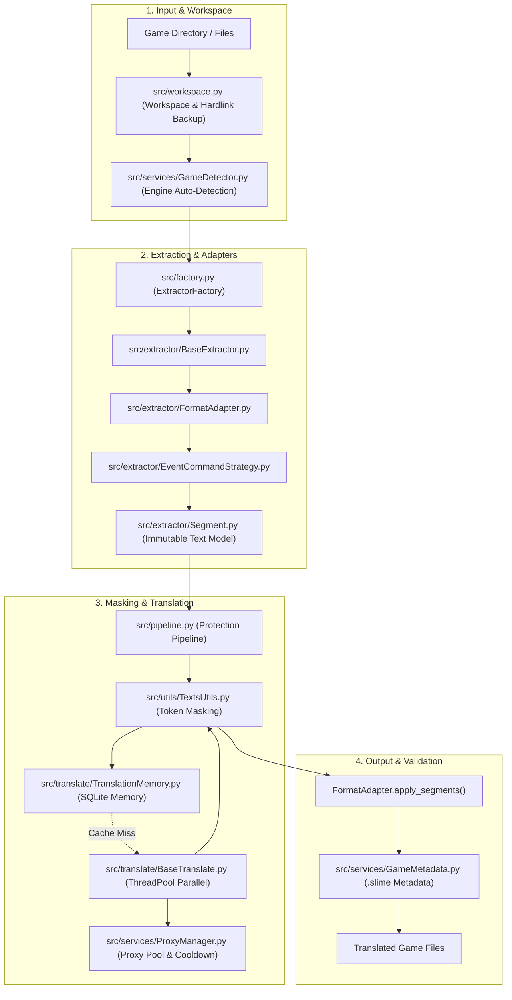

# System Architecture — Slime (Extractor & Translation)

This document provides a comprehensive technical overview of the architecture, design principles, software patterns, and data flow of **Slime**.

---

## 1. System Overview

**Slime** is a modular Python toolkit designed to extract, sanitize, mask variable tokens, translate, and reinject text into video games and structured datasets (supporting RPG Maker, WOLF RPG Editor, CSV, and JSON).

The system design relies on decoupled contracts, allowing new game engines and translation providers to be plugged in as extensions without modifying the core pipeline.



---

## 2. Core Architectural Patterns

### 2.1 Factory Method & Inversion of Control (`src/factory.py`)
Decoupled extension points are managed via decorators and Python entry points:
* `@register_extractor(name, aliases=...)`: Registers engine and file format extractors.
* `@register_translator(name, aliases=...)`: Registers translation providers.
* **Dynamic Discovery:** Automatically resolves plugins declared in `pyproject.toml` (`slime.extractors` and `slime.providers`), with a local module fallback.

### 2.2 Segment Model & Immutability (`src/extractor/Segment.py`)
All extracted text units map to a standardized `Segment` object:
* **Deterministic ID:** Generated via a stable hierarchical path (e.g., `map001:ev002:p0:cmd401:idx3`), ensuring exact 1:1 round-trip tracking.
* **Immutability:** Internal context maps use `MappingProxyType` to prevent thread-safety hazards and accidental state mutations across workers.
* **Explicit Context (`kind`):** Categorizes strings into semantic roles (`dialogue`, `choice`, `item_name`, `system`, etc.), enabling domain-specific translation prompt tuning.

### 2.3 Format Adapter Pattern (`src/extractor/FormatAdapter.py`)
Decouples file storage formats from translation domain logic:
* `extract_segments(data, file_name) -> List[Segment]`: Extracts text segments from an in-memory parsed tree.
* `apply_segments(data, segments) -> Any`: Applies translated texts back into the original data structure.
* **Memory Optimization:** Avoids expensive `copy.deepcopy` calls on large JSON trees by tracking dirty state and structural hashes.

### 2.4 Strategy Pattern for Event Walking (`src/extractor/EventCommandStrategy.py`)
Unified walker logic for traversing complex command graphs:
* `RPGMakerExtractor`: Strategy handling RPG Maker event opcodes (101/401 messages, 102 choices, 320 actor names, 355/356/357 script calls).
* `WolfRPGExtractor`: Strategy handling WOLF RPG Editor opcodes (101 messages, 102 choices, database references).

### 2.5 Pipeline & Chain of Responsibility (`src/pipeline.py`)
Text segment translation follows an ordered, isolated chain:
1. **Sanitization:** Fixes common encoding anomalies, unescaped characters, and mojibake.
2. **Masking:** Detects in-text variables and escape codes (`\V[1]`, `\N[2]`, `\C[3]`, `<center>`) and replaces them with opaque placeholders (`__XTOK_0__`).
3. **Translation Memory / Provider Dispatch:** Fast-lane memory query (RAM + SQLite); on cache miss, batches are routed to the provider.
4. **Unmasking:** Restores original variable codes at corresponding translated positions.
5. **Post-Processing & Casing Fix:** Restores uppercase/lowercase invariants on engine-specific codes.

### 2.6 Concurrency & Thread Pool (`src/translate/BaseTranslate.py`)
* Concurrent batch translation via `ThreadPoolExecutor`.
* Dynamic request throttling (`MAX_REQUESTS_SIMULTANEOUSLY`) ensures maximum network utilization without triggering provider rate limits.

---

## 3. Translation Providers

Slime supports three interchangeable translation backends:

| Provider | Module | Strategy | Best For |
| :--- | :--- | :--- | :--- |
| **Google Translate** | `src/translate/GoogleTranslate.py` | Public endpoint with delimiter-joined batches | High-volume translation and rapid initial pass |
| **DeepL API** | `src/translate/DeeplTranslate.py` | Official REST API with formality tuning | High-fidelity literary and nuanced dialogue |
| **Ollama (Local LLM)** | `src/translate/OllamaTranslate.py` | Local execution (Llama 3, Mistral, Gemma 2) | Contextual, character-aware translation with game synopsis |

### Persistent Translation Memory (`TranslationMemory.py`)
* Local SQLite storage (`cache/memory.db`).
* Compound primary key: `(source_hash, lang_source, lang_target, engine)`.
* Configured in WAL mode (*Write-Ahead Logging*) with connection pooling safe for concurrent multithreading.

---

## 4. Network Resilience & Proxy Pool (`ProxyManager.py`)

For public endpoints subject to throttling:
* Rotating pool supporting HTTP, HTTPS, and SOCKS proxies.
* Automatic detection of HTTP 429 (*Too Many Requests*) and 503 (*Service Unavailable*).
* Dynamic cooldown on degraded proxies, transparently retrying requests on healthy nodes without job interruptions.

---

## 5. Codebase Directory Structure

```text
├── main.py                     # CLI entry point, argument parsing, job coordinator
├── pyproject.toml              # Packaging metadata, dependencies, entry points
├── src/
│   ├── factory.py              # Inversion of control and dynamic plugin registration
│   ├── pipeline.py             # Sanitization, token masking, and translation pipeline
│   ├── workspace.py            # Workspace management and non-destructive backups
│   ├── job.py                  # Translation job coordination and lifecycle
│   ├── cli.py                  # Terminal User Interface (Textual TUI)
│   ├── gui.py                  # Graphical User Interface (PyQt5)
│   ├── extractor/
│   │   ├── BaseExtractor.py    # Abstract extractor base class and observers
│   │   ├── Segment.py          # Immutable text segment data model
│   │   ├── FormatAdapter.py    # File format adapter contract
│   │   ├── DetectionResult.py  # Game engine detection result models
│   │   ├── EventCommandStrategy.py # Generic event command walker
│   │   ├── CSVExtractor.py     # Delimited tabular data extractor
│   │   ├── JsonExtractor.py    # Generic JSON tree extractor
│   │   ├── rpgmaker/           # RPG Maker extractors and RVData adapters
│   │   └── wolfrpg/            # WOLF RPG extractors, Huffman decoding, and archives
│   ├── translate/
│   │   ├── BaseTranslate.py    # Base provider with integrated ThreadPool
│   │   ├── GoogleTranslate.py  # Google provider with proxy pool support
│   │   ├── DeeplTranslate.py   # DeepL API provider
│   │   ├── OllamaTranslate.py  # Local LLM provider with synopsis context
│   │   └── TranslationMemory.py# Persistent SQLite translation cache
│   ├── services/
│   │   ├── GameDetector.py     # Game engine auto-detection service
│   │   ├── GameMetadata.py     # Integrity tracking and .slime metadata
│   │   ├── ProxyManager.py     # Proxy rotation and cooldown manager
│   │   ├── SettingsStore.py    # Local settings persistence (SQLite)
│   │   └── FileNameTranslator.py# Automatic map and asset file name translator
│   └── utils/
│       ├── TextsUtils.py       # Token masking and mojibake correction
│       ├── RubyMarshal.py      # Ruby Marshal binary parser and serializer
│       ├── LanguageCodes.py    # ISO language code normalization
│       └── ClipboardUtils.py   # Clipboard integration utilities
└── tests/                      # Automated test suite (pytest)
```

---

## 6. Execution Lifecycle

1. **Initialization:** The CLI or GUI invokes `src/workspace.py` to prepare working folders (`input/`, `output/`, `.backup/`). Multimedia assets receive hardlinks to avoid disk duplication.
2. **Engine Detection:** `GameDetector.detect_game_environment` inspects files and queries registered extractors for a match.
3. **Segment Extraction:** The matched extractor calls its `FormatAdapter`, generating deterministic `Segment` items.
4. **Token Masking:** `TextsUtils` replaces escape sequences, variables, and formatting tags with opaque placeholders.
5. **Translation:**
   * `TranslationMemory` checks for pre-existing translations under the same source hash and engine.
   * New segments are batched and dispatched through the `BaseTranslate` thread pool.
6. **Unmasking & Reinjection:** Original tokens are restored, and `FormatAdapter.apply_segments` writes the translated strings back into the game structure.
7. **Audit & Metadata:** `GameMetadata` computes SHA-256 hashes and writes verification records to `.slime/meta.json`.
