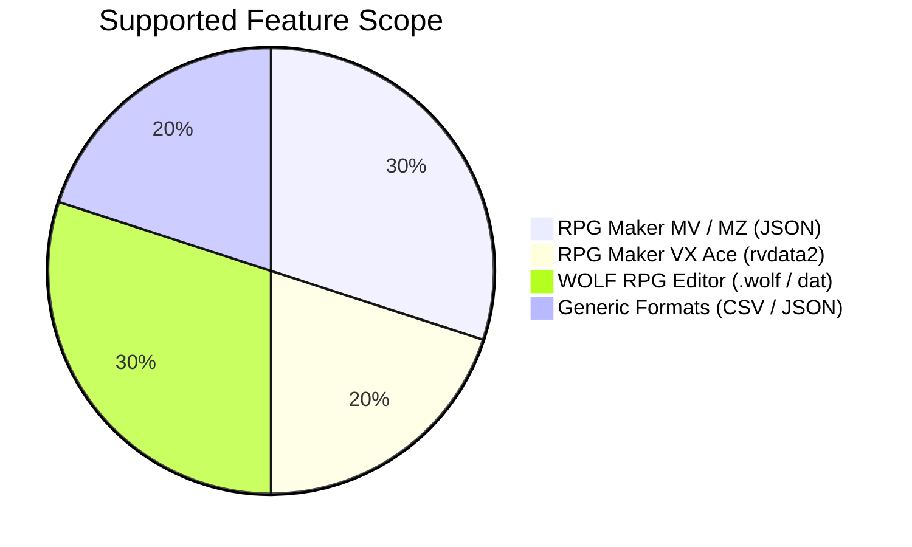

# Slime — Product Vision & Specification (PRODUCT.md)

> **Slime (Extractor & Translation):** An open-source suite for automated extraction, script-safe translation, and localization of video games and structured datasets.

---

## 1. What is Slime?

**Slime** is a purpose-built localization toolkit designed to tackle the complexities of indie game translation (with first-class support for engines like **RPG Maker** and **WOLF RPG Editor**).

Unlike generic file translation scripts that treat game files as plain text and inadvertently corrupt inline variables or syntax, Slime understands engine-specific command graphs, safely isolates scripting tokens, translates with multi-threaded parallel batching and SQLite caching, and outputs game files that run immediately without runtime errors.

---

## 2. Target Audience

1. **Fan-Translation Teams & Modding Groups:** Who translate expansive titles and require terminology consistency across hundreds of maps and system files.
2. **Indie Game Developers:** Looking to localize their games into multiple languages rapidly without rewriting core dialog management routines.
3. **Players:** Who want to translate foreign-language titles (especially Japanese or English releases) to play in their native language with minimal setup.

---

## 3. Core Problems Slime Solves

| Common Challenge | Slime Solution |
| :--- | :--- |
| **Script Token Corruption:** Standard translators alter escape codes like `\V[1]`, `\N[2]`, or `\M[ID]` to lowercase or misplace HTML tags, causing crashes or game bugs. | **Hardened Token Masking:** In-text variables, color codes, and inline scripts are converted to opaque temporary tokens before translation and restored post-translation. |
| **Proprietary Binary Formats:** WOLF RPG and RPG Maker VX Ace store data in closed binary archives (`.wolf`, `CommonEvents.dat`, `.rvdata2`). | **Native Binary Adapters:** Built-in `.wolf` archive decompression (including Huffman tree decoding), binary database reading, and pure-Python Ruby Marshal parsing. |
| **Provider Rate Limiting (HTTP 429):** Public translation endpoints block IP addresses when flooded with rapid requests. | **Proxy Pool with Dynamic Cooldown:** Transparent HTTP/HTTPS/SOCKS proxy rotation that monitors rate limits and routes around throttled nodes. |
| **Sluggish Large-File Processing:** Sequentially translating hundreds of map files can take hours. | **Parallel Batching + Fast Lane:** Multi-threaded batch translation via `ThreadPoolExecutor` paired with persistent SQLite translation memory to avoid translating repeated text. |
| **Loss of Story Context in AI Translation:** LLMs translating isolated dialog lines lose character voice, pronouns, and narrative tone. | **Ollama Integration with Synopsis:** Allows injecting game plot summaries and style guidelines into local LLMs (Llama 3, Mistral, Gemma 2) for cohesive character dialogue. |

---

## 4. Engine & Format Compatibility Matrix



### Supported Game Engines
* **RPG Maker MV / MZ:** Full parsing and reinjection for map files (`MapXXX.json`), common events (`CommonEvents.json`), troops (`Troops.json`), and system databases (`Actors.json`, `Items.json`, `System.json`, plugin parameters).
* **RPG Maker VX Ace:** Native reading, extraction, and binary serialization for Ruby Marshal object dumps (`.rvdata2`).
* **WOLF RPG Editor:** Decompression of encrypted `.wolf` packages, event databases (`CommonEvents.dat`), system descriptors, and engine game data.
* **Generic Tabular & Tree Data:** Dedicated extractors for arbitrary CSV tables and nested JSON objects.

### Supported Translation Providers
* **Google Translate (GTX):** High speed, ideal for bulk passes, backed by rotating proxy pools.
* **DeepL API:** High-fidelity neural translation with formality tuning.
* **Ollama (Local LLMs):** 100% offline, zero telemetry, supporting models like Llama 3, Mistral, Gemma 2, and Qwen.

---

## 5. User Interfaces & Operating Modes

Slime caters to different operational workflows through three unified interfaces:

```text
                  ┌──────────────────────────────────────────────┐
                  │              Slime Core Engine               │
                  └──────┬────────────────┬───────────────┬──────┘
                         │                │               │
                         ▼                ▼               ▼
                  ┌──────────────┐ ┌──────────────┐ ┌──────────────┐
                  │  PyQt5 GUI   │ │ Textual TUI  │ │ Headless CLI │
                  │(Visual Mode) │ │  (Terminal)  │ │ (Automation) │
                  └──────────────┘ └──────────────┘ └──────────────┘
```

1. **Desktop Graphical User Interface (GUI):**
   * PyQt5-based visual interface featuring real-time translation progress, file selection, engine auto-detection, and dynamic forms.
   * Command: `slime --gui`
2. **Terminal User Interface (TUI):**
   * Rich interactive terminal console built on Textual, featuring directory tree pickers, status tables, and a command palette (`ctrl+p`).
   * Command: `slime --interactive` (or `slime` without arguments)
3. **Headless Command-Line Interface (CLI):**
   * Non-interactive mode tailored for automation, scripts, and CI/CD pipelines.
   * Example: `slime -e RPGMaker -t Google -s ja -d en -i ./my_game`

---

## 6. Data Safety & Non-Destructive Workflows

* **Automatic Backups:** Slime never alters original files in-place without ensuring a timestamped copy under `.backup/`.
* **Zero Disk Bloat for Multimedia:** Heavy media files (BGM, sound effects, CG illustrations) receive hardlinks, keeping backups fully functional without duplicating gigabytes on disk.
* **Audit Metadata (`.slime/`):** Translated games receive verification records containing SHA-256 hashes for all processed assets, providing full visibility into modified, translated, or preserved files.
