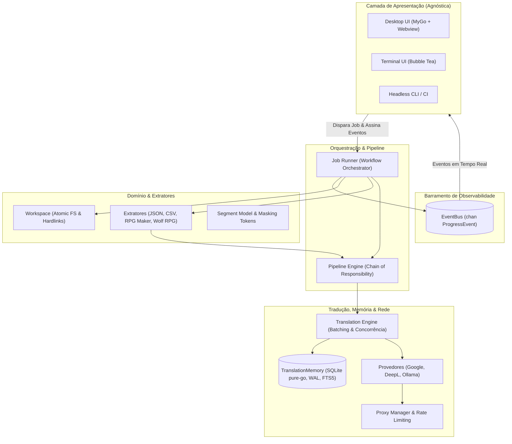
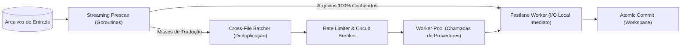

# Planejamento Arquitetural: Slime RPG (Go Edition)

Este documento detalha o desenho arquitetural do **Slime RPG** em Go, aproveitando os pontos fortes da arquitetura original e reformulando o sistema para explorar ao máximo o modelo de concorrência por canais, a segurança de tipos e o desempenho compilado sem CGO.

---

## 1. Princípios Arquiteturais Fundamentais

1. **Zero CGO**: O núcleo, a interface gráfica (MyGo) e a persistência (SQLite) devem compilar de forma puramente estática, viabilizando cross-compilação instantânea Linux $\rightarrow$ Windows sem toolchains externas.
2. **Headless & Engine First**: O motor de tradução e extração não sabe quem o consome. Toda comunicação com UIs ocorre por meio de um **EventBus assíncrono baseado em canais**.
3. **Streaming Concorrente (Fan-In / Fan-Out)**: Em vez de carregar listas inteiras de arquivos na memória para orquestração manual em threads, o Go processa fluxos contínuos de arquivos usando *pipelines de canais*.
4. **Isolamento Transacional Rígido**: Operações de disco utilizam diretórios temporários (`os.MkdirTemp`), backup com preservação de espaço via *hardlinks* (`os.Link`) e substituição atômica (`os.Rename`).
5. **Tipagem e Imutabilidade Segura**: Segmentos de texto são estruturas imutáveis (`structs` de valor ou ponteiros com getters de contexto protegido).

---

## 2. Visão Geral da Arquitetura de Camadas



---

## 3. Detalhamento dos Módulos

### 3.1. Modelo de Dados de Domínio (`pkg/model`)

* **`Segment`**: Representa uma unidade atômica de texto a ser traduzida.
  ```go
  type SegmentKind string

  const (
      KindDialogue SegmentKind = "dialogue"
      KindChoice   SegmentKind = "choice"
      KindScript   SegmentKind = "script"
      KindMenu     SegmentKind = "menu"
      KindDB       SegmentKind = "db"
  )

  type Segment struct {
      ID          string            // URI Canônica (ex: Map001.json#event:1/page:0/cmd:12)
      Source      string            // Texto original
      Target      string            // Tradução resolvida
      Kind        SegmentKind       // Obrigatório
      Context     map[string]any    // Metadados imutáveis (arquivo, ator, página)
      Constraints map[string]string // Ex: max_length, preserve_tokens
      SourceHash  string            // SHA-256 do Source normalizado
  }
  ```

### 3.2. Pipeline de Processamento (`pkg/pipeline`)

Cada arquivo ou segmento percorre uma cadeia ordenada de passos (`Step`). Cada passo opera sobre um `PipelineContext`:

```go
type Step interface {
    Name() string
    Execute(ctx context.Context, pctx *PipelineContext) error
}
```

**Cadeia Canônica de 7 Passos:**
1. `CacheLookupStep`: Consulta a `TranslationMemory`. Se todas as strings já estiverem resolvidas, pula para o passo final.
2. `PatternDetectionStep`: Identifica códigos de escape específicos da engine (ex: `\V[n]`, `\N[n]`, `\r[...]`).
3. `MaskingStep`: Substitui códigos protegidos por placeholders blindados (ex: `__XTOK_0__`).
4. `TranslationStep`: Despacha textos não resolvidos para o `TranslationEngine`.
5. `UnmaskingStep`: Restaura os códigos protegidos e valida a integridade (`MaskIntegrityError`).
6. `FixingStep`: Aplica correções pós-tradução específicas de cada motor (sanitização de literais octais, aspas tipográficas).
7. `CacheStoreStep`: Salva novos pares válidos na `TranslationMemory`.

---

### 3.3. Memória de Tradução (`pkg/memory`)

Implementada com **`modernc.org/sqlite`** (Go puro sem CGO):
* **Modo WAL (`PRAGMA journal_mode=WAL`)**: Permite leituras concorrentes em paralelo por goroutines enquanto uma única conexão grava no banco.
* **Índice FTS5**: Busca textual completa para reutilização de contextos semelhantes e glossário.
* **Tabela `segments`**:
  * Chave única: `(src_lang, tgt_lang, source_hash, engine)`.
* **API de Alto Desempenho**:
  * `LookupBatch(ctx context.Context, hashes []string) (map[string]string, error)`
  * `StoreBatch(ctx context.Context, pairs []TranslationPair) error`

---

### 3.4. Concorrência e Motor de Tradução (`pkg/translation`)

Substituição da arquitetura de pools do Python por canais concorrentes com controle de vazão:



* **Deduplicação Cross-File**: O `Batcher` recebe textos pendentes de múltiplos arquivos via canal, deduplica strings idênticas e monta blocos ótimos para a capacidade do provedor (ex: lotes de 50 strings para Google, chamadas com synopsis para Ollama).
* **Resiliência e Proxies**:
  * Rotação de proxies com cooldown exponencial em resposta a HTTP 429.
  * `context.Context` com cancelamento cascata e timeouts rigorosos por requisição.

---

### 3.5. Barramento de Eventos e Interfaces (`pkg/event` & `pkg/ui`)

```go
type StatusType string

const (
    StatusWaiting    StatusType = "waiting"
    StatusProcessing StatusType = "process"
    StatusCached     StatusType = "cached"
    StatusSuccess    StatusType = "success"
    StatusError      StatusType = "error"
)

type ProgressEvent struct {
    File      string
    Status    StatusType
    Message   string
    Current   int
    Total     int
    Timestamp time.Time
}

type EventBus interface {
    Publish(event ProgressEvent)
    Subscribe() <-chan ProgressEvent
    Unsubscribe(<-chan ProgressEvent)
}
```

* **Desktop UI (`pkg/ui/desktop` - MyGo)**:
  * Expõe métodos de controle (`StartJob`, `PauseJob`, `SelectFolder`).
  * Envia os eventos do `EventBus` para o frontend web através de IPC tipado com TypeScript.
* **Terminal UI (`pkg/ui/tui` - Bubble Tea)**:
  * Transforma o canal de eventos em mensagens `tea.Msg` no loop reativo Elm, renderizando o `DataTable` e a barra de resumo sem travamento de tela.

---

## 4. Estrutura de Pacotes Proposta

```text
slime-rpg/
├── cmd/
│   └── slime/                   # Entry point (CLI flags: --gui, --tui, --input, etc.)
├── pkg/
│   ├── model/                   # Segment, GameEnvironment, Configs
│   ├── event/                   # EventBus thread-safe para UIs
│   ├── workspace/               # Gerenciador de pastas temporárias, backups e commits
│   ├── memory/                  # TranslationMemory (SQLite WAL pure-go)
│   ├── pipeline/                # Steps de mascaramento, tradução e unmasking
│   ├── translation/             # Orquestrador de lotes e deduplicação cross-file
│   ├── provider/                # Provedores de tradução
│   │   ├── google/              # Google Translate + Proxy Pool
│   │   ├── deepl/               # DeepL REST API
│   │   └── ollama/              # Ollama local LLM
│   ├── extractor/               # Extratores de formato
│   │   ├── base/                # Interfaces e adaptadores comuns
│   │   ├── json/                # Extrator JSON genérico (RFC 6901)
│   │   ├── csv/                 # Extrator CSV
│   │   ├── rpgmaker/            # Motor RPG Maker (MV/MZ JSON primeiro; RVData depois)
│   │   └── wolfrpg/             # Motor Wolf RPG (MPS, DataBase, DXA, Huffman)
│   └── ui/
│       ├── tui/                 # Bubble Tea, Bubbles e Lip Gloss
│       └── desktop/             # MyGo Backend e bindings TypeScript
├── Taskfile.yml                 # Automação de tarefas
├── go.mod / go.sum              # Dependências
└── GEMINI.md / AGENTS.md        # Diretrizes e memórias do projeto
```

---

## 5. Fases de Execução da Arquitetura

1. **Sprint 1 — Núcleo & Modelos (`pkg/model`, `pkg/event`, `pkg/workspace`)**:
   * Definição de `Segment`, validações de `Kind`, `EventBus` concorrente e `Workspace` com substituição atômica de arquivos.
2. **Sprint 2 — Persistência & Cache (`pkg/memory`)**:
   * Criação do schema SQLite WAL, migrações internas e testes de benchmark de leitura/gravação concorrente.
3. **Sprint 3 — Pipeline & Extrator Piloto (JSON e RPG Maker MV/MZ)**:
   * Implementação do `Pipeline` completo (mascaramento de variáveis do RPG Maker `\V[n]`, `\N[n]`).
   * Extrator de JSON/MV/MZ rodando ponta a ponta com tradução simulada (mock) ou provider real.
4. **Sprint 4 — Provedores de Tradução (`pkg/provider`)**:
   * Google Translate batched com rotação de proxy, DeepL e Ollama.
5. **Sprint 5 — UIs (TUI Bubble Tea e Desktop MyGo)**:
   * Interface de terminal interativa com tabela de progresso concorrente.
   * Janela desktop MyGo conectada via IPC tipado.
6. **Sprint 6 — Motores Binários Complexos**:
   * Wolf RPG (Huffman, DXA e arquivos binários).
   * RPG Maker legado (Ruby Marshal para `.rvdata` / `.rxdata`).
